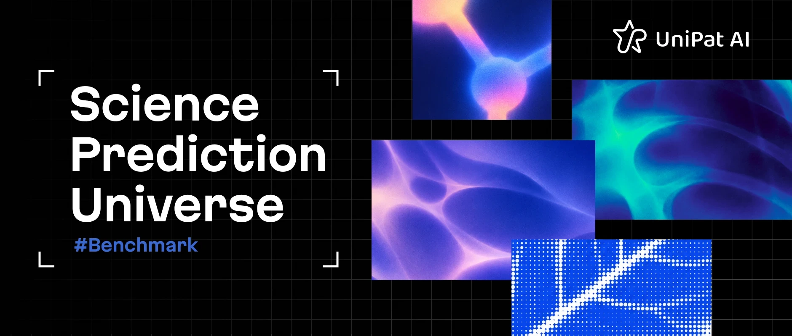
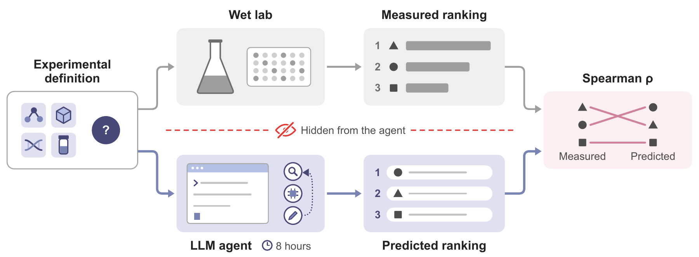
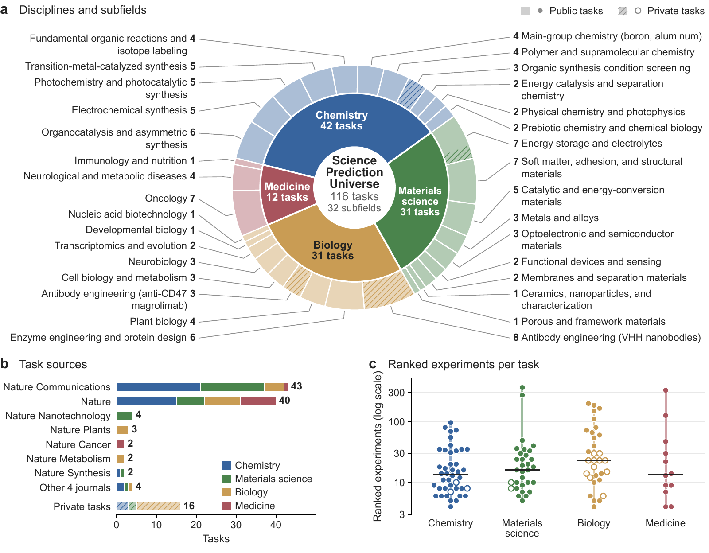
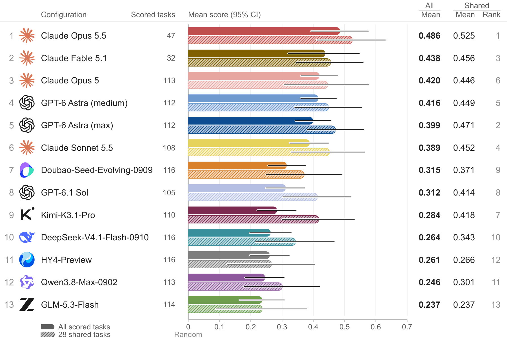

<p align="center"></p>

# Science Prediction Universe (SPU)

[Paper](paper/Science_Prediction_Universe.pdf) · [Homepage](https://spu.unipat.ai/) · [Dataset](https://huggingface.co/datasets/UnipatAI/SPU) · [Blog](https://unipat.ai/blog/SciencePredictionUniverse)

<p align="center"></p>

Science Prediction Universe (SPU) is a benchmark of hidden wet-lab outcomes. Each task fixes the candidates, materials, conditions and measurement protocol of a real experiment, and an agent ranks the candidates by the measured outcome. Rankings are scored by Spearman correlation against the measurements.

SPU has 100 public tasks, built from 85 papers in 11 Nature Portfolio journals across chemistry, materials science, biology and medicine, and 16 private tasks from unpublished wet-lab experiments. The private tasks are not released.

<p align="center"></p>

## Results

Thirteen agent configurations, each run once on every task with an eight-hour budget, rank the measured outcomes far from perfectly: the best mean is below 0.5 on a scale where a perfect ranking scores 1 and random rankings average 0.

<p align="center"></p>

Means over the public and private tasks on which each configuration has a scored run, with 95% bootstrap intervals over tasks. Claude Opus 5.5 and Claude Fable 5.1 are scored on fewer tasks because most of their runs ended in safety refusals. Hatched bars are means on the 28 tasks that all thirteen configurations completed, and the right-hand column ranks the configurations on those tasks. See the paper for task-adjusted means, paired tests and cost.

## Run the benchmark

The 100 public tasks are released as complete [Harbor](https://harborframework.com/) tasks on Hugging Face, with measurements, graders and oracle solutions:

```bash
hf download UnipatAI/SPU --repo-type dataset --local-dir SPU && cd SPU
harbor run -p tasks/fluorene-dehydration-concentrations -a oracle -e docker \
  --override-gpus 0 --override-cpus 1 --override-memory-mb 1024 -o ../jobs
```

The [dataset card](https://huggingface.co/datasets/UnipatAI/SPU) describes the run budget used in the paper, scoring and how to report results.

## What this repository is for

This repository is where the community contributes new tasks and reports problems:

- **New task**: open a pull request with a detailed task plan, a reference ranking workbook and supporting data under `submissions/<task-id>/`. See [CONTRIBUTING.md](CONTRIBUTING.md) and the [templates](templates/submission/README.md).
- **Correction to a task**: open a task issue, then a fix pull request.
- **Unpublished or restricted experiments**: do not open a PR. Use the private workspace on the [SPU project site](https://spu.unipat.ai/#/workspace).

Every task PR gets two automatic checks: `spu/pr-format` (title and description, see [docs/PR-FORMAT.md](docs/PR-FORMAT.md)) and `spu/clarity-audit` (an AI completeness review of the plan and data, see [docs/REVIEW.md](docs/REVIEW.md)). These check completeness, not scientific validity; maintainers review every task before acceptance.

The project site and its services are developed separately.

## Authors

**Project Team:** Zengji Tu<sup>1*</sup>, Xiang Liu<sup>1*</sup>, Jiarui Sun<sup>1</sup>, Ruoyu Wu<sup>1</sup>, Zhihui Qi<sup>1</sup>, Chengda Wu<sup>1</sup>, Yutao Zhou<sup>1</sup>, Bo Yang<sup>1</sup>, Ziyan Zhang<sup>1</sup>, Jialong Wu<sup>1</sup>, Liang Chen<sup>1†‡</sup>, Kuan Li<sup>1†</sup>

**Advisory Committee:** Steven Dillmann<sup>2</sup>, Yuanqi Du<sup>3</sup>, Soojung Yang<sup>4</sup>, Shizhe Diao<sup>5</sup>, Jianjun Wu<sup>6</sup>, Junlang Liu<sup>7</sup>, Xuming Hu<sup>8</sup>, Lin Chang<sup>6,9†</sup>, Baobao Chang<sup>10</sup>, Xiaowen Chu<sup>8</sup>, Philip S. Yu<sup>11</sup>, Tong-Yi Zhang<sup>8,12</sup>

**Wet-Lab Collaborators:** Hao Cheng<sup>13</sup>, Qin Han<sup>13</sup>, Yanye Feng<sup>14</sup>, Chenru Duan<sup>15</sup>, Chuncheng Liu<sup>15</sup>, Yan Liu<sup>15</sup>, Yuchen Gao<sup>15</sup>, Zhao Li<sup>15</sup>, Ronghua Zhang<sup>15</sup>, Tory Xu<sup>15</sup>, Renjian Song<sup>16</sup>, Yaokai Fu<sup>16</sup>

<sup>*</sup>Core contributors. <sup>†</sup>Corresponding authors: Liang Chen (<a href="mailto:liangchen@unipat.ai">liangchen@unipat.ai</a>), Kuan Li (<a href="mailto:kuanli@unipat.ai">kuanli@unipat.ai</a>), Lin Chang. <sup>‡</sup>Project leader: Liang Chen.

<details>
<summary>Affiliations</summary>

1. UniPat AI
2. Stanford University
3. Cornell University
4. FutureHouse
5. The Hong Kong University of Science and Technology
6. State Key Laboratory of Photonics and Communications, School of Electronics, Peking University
7. Department of Chemistry and Chemical Biology, Harvard University
8. The Hong Kong University of Science and Technology (Guangzhou)
9. Frontiers Science Center for Nano-optoelectronics, Peking University
10. Peking University
11. University of Illinois Chicago
12. Shanghai University
13. Yurogen Biosystems LLC
14. ABclonal Biotechnology Co., Ltd.
15. Deep Principle
16. Bota Biosciences

</details>

## Citation

```bibtex
@misc{spu2026,
  title  = {Science Prediction Universe},
  author = {Tu, Zengji and Liu, Xiang and Sun, Jiarui and Wu, Ruoyu and Qi, Zhihui and Wu, Chengda and Zhou, Yutao and Yang, Bo and Zhang, Ziyan and Wu, Jialong and Chen, Liang and Li, Kuan and Dillmann, Steven and Du, Yuanqi and Yang, Soojung and Diao, Shizhe and Wu, Jianjun and Liu, Junlang and Hu, Xuming and Chang, Lin and Chang, Baobao and Chu, Xiaowen and Yu, Philip S. and Zhang, Tong-Yi and Cheng, Hao and Han, Qin and Feng, Yanye and Duan, Chenru and Liu, Chuncheng and Liu, Yan and Gao, Yuchen and Li, Zhao and Zhang, Ronghua and Xu, Tory and Song, Renjian and Fu, Yaokai},
  year   = {2026},
  url    = {https://spu.unipat.ai}
}
```

## License

Code in this repository is licensed under the [Apache License 2.0](LICENSE). The SPU dataset on Hugging Face is released under CC BY 4.0. UniPat brand assets are not covered by either license.

Contact: Liang Chen ([liangchen@unipat.ai](mailto:liangchen@unipat.ai)), Kuan Li ([kuanli@unipat.ai](mailto:kuanli@unipat.ai)).
